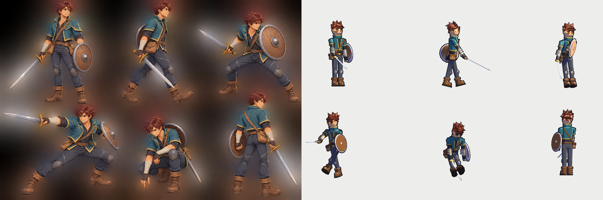

# Personagem jogável: o aventureiro

Referência principal: [Art/Referencias/aventureiro-seis-poses.png](../Art/Referencias/aventureiro-seis-poses.png)
(seis poses do mesmo personagem; usadas como referência de identidade, roupa, equipamento, proporção e
linguagem corporal, não como quadros de animação).



## Como o personagem foi construído

O jogo é **3D low-poly com shader toon** (Unity 6000.6.4f1, Built-in RP), câmera em terceira pessoa a 2,5–12 m.
O herói segue as convenções já existentes no projeto, sem pipeline novo:

- **Modelo gerado por script** no Blender (`Tools/Blender/build_models.py`, função `humanoid("heroi")`),
  exportado para `Zeldexile/Assets/Zeldexile/Resources/Models/Characters/heroi.fbx`; fonte editável em
  `Art/Blender/heroi.blend`. 5.794 triângulos.
- **Esqueleto de 26 ossos com segmentos rígidos** (detalhes em "Esqueleto" abaixo): cada malha se chama
  `Osso~Peça@slot` e o Unity remonta a hierarquia (`CharacterRig.Build`). Cada peça pertence a um osso, então
  cotovelos, joelhos, pulsos, tornozelos, coluna e pescoço dobram. Não há malha com pesos de pele: as juntas
  são cobertas por peças de junta (esferas de manga no cotovelo, de calça no joelho), como no resto do jogo.
- **Cores por slot**, sem texturas: `RigStyle.Hero` e `RigStyle.ColorFor` definem a paleta, tirada das áreas
  de cor base da referência (não dos brilhos e sombras). O cel shading vem dos shaders `Zeldexile/Toon` e
  `Zeldexile/ToonOutline`.
- **Eixos:** frente do personagem = +Z, direita = +X, cima = +Y (espaço do Unity), 1 unidade = 1 m.

| Elemento | Construção |
|---|---|
| Rosto | Olhos âmbar com pálpebra superior escura e brilho, sobrancelhas castanhas, nariz e boca pequenos, queixo definido, orelhas humanas arredondadas |
| Cabelo | Castanho-avermelhado, volume no topo, 14 mechas curtas e irregulares, franja fragmentada que para acima das sobrancelhas |
| Jaqueta | Azul-petróleo, curta até a cintura, gola levantada com borda ocre, barra e punhos ocre, lapelas ocre, abertura em V mostrando a camisa |
| Camisa | Carvão, visível no peito e nas mangas até o cotovelo |
| Antebraços e mãos | Faixas claras enroladas, luvas escuras sem dedos com os dedos à mostra |
| Calça | Cinza-azulado, costuras laterais e no joelho, joelheiras arredondadas |
| Botas | Marrons, cano médio com dobra, duas tiras com fivela, solado escuro |
| Cinto e bolsa | Cinto marrom com fivela de latão; bolsa no **quadril direito**; alça do **ombro esquerdo** ao quadril direito, na frente e nas costas |
| Espada | Lâmina reta de aço com ponta, guarda de latão, cabo escuro, pomo; na **mão direita** |
| Escudo | Redondo, madeira com tábuas marcadas, aro de ferro, umbo central, 8 rebites, correia interna; no **antebraço esquerdo** |

## Esqueleto

```
Quadril (raiz, centro de gravidade)
 ├ Tronco (lombar: cintura, cinto) ─ Bolsa (secundário, balança)
 │  └ Tórax (peito, gola, alça, equipamento nas costas) ─ Planador
 │     ├ Pescoço ─ Cabeça ─ Mandíbula
 │     └ Clavícula E/D ─ Braço E/D (ombro) ─ Cotovelo E/D ─ Pulso E/D ─ Dedos E/D
 └ Perna E/D (quadril) ─ Joelho E/D ─ Tornozelo E/D ─ Ponta do pé E/D
```

| Osso | O que move | Como é animado |
|---|---|---|
| Quadril | Corpo inteiro | No chão, a altura vem das pernas: desce até o calcanhar, a ponta do pé ou o joelho mais baixo tocar o solo |
| Tronco + Tórax | Coluna em dois segmentos | Cada pose dá uma rotação de tronco; a lombar fica com 45% e o peito com 55% |
| Pescoço + Cabeça | Olhar | O pescoço fica com 40% da rotação da cabeça |
| Mandíbula | Queixo e boca | Abre no grito do golpe pesado, na estocada e no dano |
| Clavículas | Ombro | Sobem e avançam sozinhas quando o braço sobe ou vai à frente |
| Cotovelos | Antebraço, escudo | Dobra em todas as poses: guarda, recuo antes do golpe, extensão no corte |
| Pulsos | Mão e o que ela segura | Engatilha antes do corte e estala na passagem; espada e arco presos aqui |
| Dedos | Dedos | Fecham ao segurar espada, escudo, arco, parede e planador; abrem ao arremessar e soltar a flecha |
| Joelhos | Canela e bota | Flexão na passada, agachamento, ajoelhar, aterrissagem, estocada |
| Tornozelos | Pé | No chão o pé fica plano; levanta o calcanhar no impulso da passada; aponta no nado e no pulo |
| Pontas dos pés | Biqueira | Dobram quando o calcanhar sobe e no joelho apoiado |
| Bolsa | Bolsa do quadril | Mola amortecida: fica para trás na corrida e quica com o quadril |

**Fora do esqueleto, de propósito:** ossos de torção do braço, do antebraço, da coxa e da canela só servem
para distribuir rotação numa malha com pesos, que este modelo não tem. O rig facial com dezenas de ossos e as
três falanges por dedo não cabem no rosto chapado e nas mãos de bloco único do low-poly. Cabelo e alças continuam
rígidos.

## Equipamento por estado

Cada item existe duas vezes no modelo (guardado e na mão) e só uma das duas aparece. A regra está em
`CharacterRig.Classify` e é aplicada por `HeroPresenter` (jogo), `CharacterShowcase` (vitrine) e pelos testes.

| Estado | Espada | Escudo | Arco |
|---|---|---|---|
| Exploração | Bainha nas costas | Nas costas | Nas costas (se tiver) |
| Em combate (4 s após atacar, alvo travado ou escudo erguido) | Mão direita | Antebraço esquerdo, face para fora | Nas costas |
| Defendendo | Mão direita | Braço cruzado à frente, face para a ameaça | Nas costas |
| Mirando | Bainha | Nas costas | Mão esquerda |

**Decisão registrada:** a referência nunca mostra a espada guardada. Usei uma bainha de couro nas costas, à
esquerda, com só a guarda e o pomo à mostra; ela some quando a espada está na mão, para que as costas fiquem
limpas como na pose traseira da referência. A lâmina sai do punho 30° à frente do antebraço, o que reproduz o
repouso da referência (espada diagonal, para baixo e à frente) e deixa a estocada quase nivelada sem uma
junta de pulso.

## Animações

Procedurais, em `CharacterAnimator`, dirigidas pelas ações reais do jogo. O deslocamento continua sendo do
código (`PlayerMotor`); a animação não move o personagem. Cada pose define os ossos principais; coluna,
pescoço, clavículas, pés no chão, altura do quadril e bolsa são derivados automaticamente.

| Ação do jogo | Animação | Pose da referência |
|---|---|---|
| Parado | Respiração, olhar ao redor; em combate, espada baixa à frente | 1 (repouso) |
| Andar / correr | Ciclo com passada proporcional à velocidade | 2 (caminhada) |
| Escudo erguido (Q segurado) | Braço esquerdo cruzado à frente, postura baixa | 3 (defesa) |
| Ataque uma mão | Combo alternando corte lateral e de cima | 4 (extensão) |
| Ataque lança | Estocada com passo | 4 (extensão) |
| Ataque duas mãos | Golpe de cima com o corpo todo | — |
| Pegar objeto / interagir | Agachar e alcançar o chão | 5 (agachado) |
| Panela e estátua | Ajoelhar | 5 |
| Arremesso, tiro, runa, dano, defesa perfeita, aterrissagem, pulo, escalada, salto de escalada, planador, nado, dash aquático | Poses próprias | — |

## Arquivos

| Arquivo | O que mudou |
|---|---|
| `Tools/Blender/build_models.py` | Herói refeito (`humanoid`, `round_shield`), slots novos |
| `Art/Blender/heroi.blend`, `Resources/Models/Characters/heroi.fbx` | Modelo regenerado |
| `Art/Referencias/aventureiro-seis-poses.png` (+ prompt) | Referência dentro do repositório |
| `Scripts/Runtime/Characters/CharacterRig.cs` | Esqueleto de 26 ossos, pontos de contato com o chão, paleta, `Classify`/`GearPart` |
| `Scripts/Runtime/Characters/ModelLibrary.cs` | Slots finos sem contorno |
| `Scripts/Runtime/Characters/HeroPresenter.cs` | Equipamento por estado, pivô da lâmina no punho |
| `Scripts/Runtime/Characters/CharacterAnimator.cs` | Poses com todos os ossos, movimento derivado, pés plantados, mola da bolsa |
| `Scripts/Runtime/Gameplay/CharacterShowcase.cs` | Vitrine com todas as ações |
| `Scripts/Runtime/Gameplay/BuildCapture.cs` | `Zeldexile.exe -vitrine` abre a vitrine |
| `Scripts/Editor/PrototypeSceneBuilder.cs`, `WindowsBuild.cs` | Cena `Showcase.unity` e inclusão na build |
| `Tests/PlayMode/VisualPreviewTests.cs` | Prancha das seis poses, volta completa, rosto, ações |
| `Tests/PlayMode/ShowcaseCaptureTests.cs` | Grava a vitrine quadro a quadro (explícito) |
| `Tools/make_showcase_video.py` | Monta o MP4 com o nome de cada ação |
| `Docs/media/*` | Capturas e vídeo |

## Como abrir e testar

- **Jogo:** `Builds\Windows\Zeldexile.exe`. Clique ataca (a espada sai das costas), segurar Q ergue o escudo,
  F arremessa, E pega objetos (agacha), Tab abre a bolsa.
- **Vitrine:** `Builds\Windows\Zeldexile.exe -vitrine`, ou no editor a cena `Assets/Zeldexile/Scenes/Showcase.unity`
  (menu **Zeldexile → Criar cena de vitrine do herói** recria).
- **Prévias:** rode os testes PlayMode; as imagens saem em `Zeldexile/Logs/preview-hero-*.png`.
- **Vídeo:** rode o teste `Zeldexile.Tests.ShowcaseCaptureTests` pelo nome e depois
  `python Tools/make_showcase_video.py` (precisa de `pillow` e `imageio[ffmpeg]`).
- **Modelo:** edite `humanoid()` no script do Blender, regenere (comando no README) e use
  **Zeldexile → Reimportar modelos do Blender**.

## Mídia

- Seis poses no motor: [media/heroi-mockup.png](media/heroi-mockup.png)
- Volta completa (frente, três quartos, perfil, costas): [media/heroi-turnaround.png](media/heroi-turnaround.png)
- Rosto: [media/heroi-face.png](media/heroi-face.png)
- Gameplay: [media/heroi-gameplay.png](media/heroi-gameplay.png)
- Todas as ações: [media/heroi-poses.png](media/heroi-poses.png), [media/heroi-acoes-quadros.png](media/heroi-acoes-quadros.png)
- Vídeo das ações (32 s): [media/heroi-acoes.mp4](media/heroi-acoes.mp4)

## Limitações reais

- **Segmentos rígidos, sem pele com pesos:** o esqueleto dobra em todas as juntas, mas cada peça é rígida. Em
  dobras fortes, as esferas de junta cobrem a emenda em vez de a malha se deformar. Malha com pesos e ossos de
  torção seriam uma mudança de pipeline.
- **Sem IK de mãos:** os pés se ajustam ao chão plano, mas as mãos não procuram o objeto ou a parede.
- **Sem texturas:** materiais são cores chapadas por slot com o toon do projeto; madeira, couro e metal se
  distinguem por cor, contorno e geometria (tábuas, rebites), não por textura.
- **Expressões faciais:** o rosto é fixo; não há animação facial.
- **Teste visual em execução:** as verificações foram feitas pelas capturas renderizadas no motor (testes
  PlayMode) e pelo vídeo gravado da vitrine. Não houve sessão de jogo manual com teclado.
