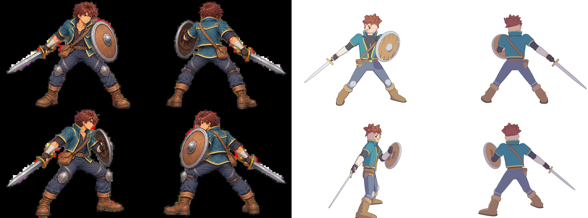
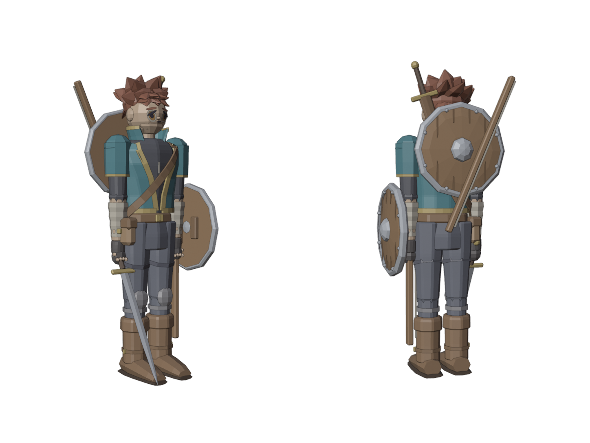
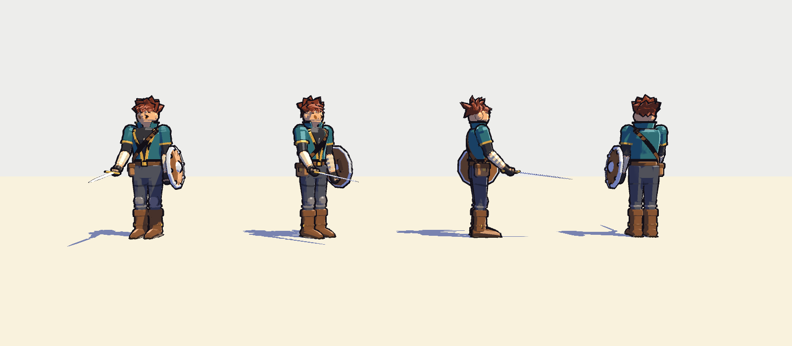

# Herói em alta (NPR / cel shading) — Blender + EEVEE

Versão de alta resolução do aventureiro, em estilo anime (cel shading de dois tons, contorno preto, rosto
com sombra lisa). É **arte para render, concept ou fonte de baking**; não é o herói do jogo, que continua
sendo o low-poly chanfrado de `Tools/Blender/build_models.py` (ver [Personagem-Aventureiro.md](Personagem-Aventureiro.md)).

Referência: [Art/Referencias/aventureiro-quatro-vistas.png](../Art/Referencias/aventureiro-quatro-vistas.png)
(frente 3/4, costas, perfil defensivo, 3/4 de costas).



## Arquivos

| Arquivo | O que é |
|---|---|
| `Tools/Blender/build_hero_hd.py` | Script que gera tudo: malha, materiais toon, contorno, esfera de normais, pose, câmeras, renders |
| `Art/Blender/heroi_hd.blend` | Resultado salvo, editável (147 malhas, materiais e modificadores à mão) |
| `Art/Render/heroi_hd_{frente,costas,perfil,costas_3_4}.png` | As quatro vistas (1448×1086, fundo transparente) |
| `Art/Render/heroi_hd_comparacao.png` | Referência (2×2) ao lado dos renders (2×2) |
| `Art/Render/heroi_hd_relatorio.txt` | Contagem de triângulos |
| `Tools/Blender/build_hero_game.py` | Versão para o jogo: low-poly chanfrado, FBX plano com os ossos do CharacterRig |
| `Zeldexile/.../Resources/Models/Characters/heroi_npr.fbx`, `Art/Blender/heroi_npr.blend` | Modelo do jogo (não substitui o `heroi.fbx`) |
| `Art/Render/heroi_npr_previa.png` | Prévia do low-poly (Workbench, cores por slot) |

Contagem: **20.882 triângulos na malha base**; **226.920 avaliados** (com Subdivision Surface e espessura da
jaqueta/gola) e **425.432 com o contorno** (o inverted hull duplica cada malha que o usa). Para comparar, o
herói do jogo tem 5.794.

## Como rodar

Em lote (gera, salva o .blend, renderiza as quatro vistas):

```bash
"E:/Steam/steamapps/common/Blender/blender.exe" -b -P Tools/Blender/build_hero_hd.py
```

Montar a prancha de comparação (Python do sistema, precisa de Pillow):

```bash
python Tools/Blender/build_hero_hd.py --compose
```

Opções depois de `--`: `--blend <arquivo>`, `--render <pasta>`, `--ref <imagem>`, `--no-render`.

### Na aba Scripting do Blender

1. Abra o Blender (3.6+), vá na aba **Scripting**.
2. No editor de texto, **Text > Open** e escolha `Tools/Blender/build_hero_hd.py` (ou cole o conteúdo num texto novo).
3. **Run Script** (Alt+P). O personagem aparece na coleção **"Herói HD"** com materiais, modificadores e
   pose; nesse modo o script **não salva nem renderiza** nada, só constrói. Rodar de novo apaga e refaz a coleção.
4. Para ver o cel shading no viewport: **Material Preview** ou **Rendered** (motor EEVEE). Em Solid você vê
   só as cores de visualização.

## Como o NPR está montado

### 1. Toon shader (cel shading)

Cada material (`toon_material` no script) é a cadeia:

```
Diffuse BSDF → Shader to RGB → Color Ramp (Constant, corte em 0.42) → Mix (Fac)
                                                                       ├ Color1 = cor de sombra
                                                                       └ Color2 = cor base      → Emission → Output
```

- **Shader to RGB** transforma a iluminação da cena (sol + mundo, com sombras) num valor de cor.
- **Color Ramp em modo Constant** faz o corte abrupto: abaixo do limiar é sombra, acima é luz, sem degradê.
- O resultado escolhe entre a **cor base** e a **cor de sombra** (base escurecida e puxada para o azul,
  calculada no script) e sai por um **Emission**, para que nenhuma luz volte a suavizar o resultado.
- Olhos, pálpebras e boca usam material **chapado** (só Emission): não reagem à luz, como em anime.
- Constantes: `TOON_THRESHOLD` (limiar), `COLORS` (paleta, tirada das áreas chapadas da referência).

### 2. Contorno por inverted hull

`add_outline` em cada malha que leva contorno:

- Modificador **Solidify**: `thickness = 0.003`, `offset = 1` (cresce para fora), **Flip Normals** ligado,
  **Rim** desligado, **Material Offset = 1**.
- Material **"Contorno"**: Emission preto, **Backface Culling** ligado, sombra `None`.

O casco expandido tem as normais viradas para dentro, então o backface culling esconde a parte dele que
está de frente para a câmera; só a borda, atrás da silhueta, aparece como linha preta. A ordem dos
modificadores é: espessura da peça → Subdivisão/Chanfro → **Contorno por último**, para a linha ter
espessura uniforme sobre a malha já suavizada. `OUTLINE_THICKNESS` está em metros; 0,003 dá uma linha de
~1 px num personagem de 1,8 m renderizado a 1086 px de altura (os renders são feitos em 2× e reduzidos
para o contorno ficar suavizado). Para uma linha mais grossa use 0,005–0,008.

### 3. Rosto com sombra lisa (esfera invisível + Data Transfer)

O problema: nariz, maçãs do rosto e queixo têm normais próprias, então a luz cria sombrinhas realistas que
quebram o visual de anime. A solução (a mesma do Genshin Impact) é o rosto **emprestar as normais de uma
esfera**: a sombra passa a cruzar o rosto como uma curva única e limpa, igual à de uma bola.

O script já faz isso (objeto **"Rosto Normais"**, modificador **"Normais do Rosto"** no Crânio, Mandíbula e
Nariz). Para fazer à mão, ou aplicar a outro personagem:

1. **Crie a esfera:** Add > Mesh > UV Sphere. Posicione-a no centro da cabeça, cobrindo o rosto inteiro
   (ligeiramente maior que o crânio; escale em Z se o rosto for alongado). Shade Smooth nela.
2. **Deixe-a invisível:** no Outliner, desligue a câmera (não renderiza); em Object Properties > Viewport
   Display, Display As = **Wire**, para ela não atrapalhar.
3. **Prepare a malha do rosto:** selecione o rosto; em Object Data Properties > Normals, ligue
   **Auto Smooth** (ângulo 180°). Sem isso o Blender 3.6 ignora normais customizadas.
4. **Adicione o Data Transfer:** Modifier Properties > Add Modifier > **Data Transfer**.
   - Source = a esfera.
   - Ligue **Face Corner Data**, marque **Custom Normals**.
   - Mapping = **Projected Face Interpolated** (`POLYINTERP_NEAREST`): cada ponto do rosto recebe a normal
     do ponto da esfera mais próximo.
5. **Ordem dos modificadores:** depois do Subdivision Surface (que recalcula normais) e **antes** do
   Solidify do contorno. Se o rosto não mudar, clique em **Generate Data Layers** no próprio modificador.
6. **Verifique:** em Material Preview com um sol, gire a luz. A sombra deve atravessar o rosto como uma
   curva única; o nariz não deve mais projetar sombra própria, só a sua silhueta no contorno.
7. **Ajuste fino (opcional):** achatando a esfera na frente (escala Y menor) a sombra fica mais "reta" na
   face, como nos rostos de anime; esferas mais altas que largas suavizam as bochechas. Faça a esfera filha
   do osso da cabeça para ela acompanhar a animação.

Dica: no jogo, o mesmo efeito se obtém fazendo baking das normais da esfera para uma normal map do rosto,
ou escrevendo normais customizadas no FBX (o Unity as respeita).

## Construção do modelo

Mesmo princípio do herói do jogo, mas suave: cada peça é um *loft* (anéis elípticos empilhados), esfera ou
fita, com **Subdivision Surface nível 2** (peças orgânicas) ou **Bevel** (peças duras: fivelas, guarda,
bolsa). As peças são filhas de empties com os nomes do esqueleto do jogo (Quadril, Tronco, Tórax, Pescoço,
Cabeça, Braço/Cotovelo/Pulso E/D, Perna/Joelho/Tornozelo E/D, Bolsa, Espada, Escudo) e a pose de combate é
dada rotacionando esses empties (`pose()` no script), com esferas cobrindo as juntas.

| Elemento | Construção |
|---|---|
| Jaqueta | Casca aberta na frente (V que alarga para cima) com Solidify de 14 mm; lapelas, barra, punhos e borda da gola em fitas douradas |
| Camisa | Loft escuro sob a jaqueta, com dois cordões cruzados no decote |
| Cabelo | Touca recuada + 30 mechas em cunha: coroa inclinada para frente, laterais varridas para trás, franja fragmentada em duas fileiras, nuca |
| Rosto | Crânio esférico, mandíbula em loft afunilado, olhos em discos chapados (esclera, íris âmbar, pupila, brilho, pálpebra), sobrancelhas, nariz e boca |
| Braços | Ombro esférico, manga da jaqueta curta sobre manga escura até o cotovelo, antebraço enfaixado (anéis alternados), luva escura com dedos de pele |
| Calça | Coxas e canelas em loft, listras cinza inclinadas, joelheiras de aço em esfera achatada |
| Botas | Cano com dobra mais clara, tira com fivela, pé em loft deitado, sola escura, cadarços |
| Espada | Lâmina de seção losango com Bevel, guarda e pomo de latão, cabo escuro; na mão direita, continuando a linha do braço |
| Escudo | Disco de madeira abaulado, aro de aço (sem tampas), umbo, 8 rebites, linhas de tábua; preso ao antebraço esquerdo, face virada para a frente |

## Versão para o jogo (`heroi_npr`)



`Tools/Blender/build_hero_game.py` deriva do mesmo construtor uma versão nas regras do jogo e a exporta
para `Zeldexile/Assets/Zeldexile/Resources/Models/Characters/heroi_npr.fbx` (fonte: `Art/Blender/heroi_npr.blend`).
**O jogo usa este modelo** (`RigStyle.Hero.Model = "heroi_npr"` em `CharacterRig.cs`); o `heroi.fbx` anterior
continua no projeto, e voltar a ele é trocar a string. Verificado no Unity 6000.6.4f1 em batch:
`ModelImportTests` e `VisualPreviewTests` (4/4) passam, e as prévias `Zeldexile/Logs/preview-hero-*.png` e
`preview-poses.png` mostram o rig animando o modelo com a troca de equipamento (mão ↔ costas).



Duas regras aprendidas com o contorno do jogo (`Zeldexile/ToonOutline` cresce o casco **a partir do centro
da peça**, 2,2 cm, feito para peças convexas):

- Cascas finas (jaqueta, gola, mangas) precisam de espessura **para dentro** maior que o contorno: no modo
  `LOW` o Solidify usa 4 cm com `offset = -1`. Com 1,4 cm a face interna "vazava" e a jaqueta ficava preta.
- Discos chapados do rosto não podem ter contorno: esclera e brilho usam o slot novo `eyewhite` (adicionado a
  `ModelLibrary.NoOutline`; `ColorFor` devolve branco para slot desconhecido) e a sobrancelha usa `dark`.

```bash
"E:/Steam/steamapps/common/Blender/blender.exe" -b -P Tools/Blender/build_hero_game.py
```

O que muda em relação ao HD:

- `build_hero_hd.py` roda em modo `LOW` e `POSE = False`: lofts com 8 (ou 12) lados, esferas 8×6, mechas
  com 6 lados, sem Subdivision, sem contorno, sem esfera de normais; pose de descanso (braços caídos, espada
  30° à frente do antebraço, escudo no lado de fora do antebraço esquerdo), que é o que o rig espera.
- O conversor gira tudo 180° em Z (o HD tem a frente em -Y; no pipeline do jogo a frente é +Y no Blender =
  +Z no Unity), aplica o **chanfro de 1 segmento** (1 cm nas peças grandes, o Bevel das peças duras nos
  detalhes, zero em esferas e mechas), centra a origem de cada peça, deixa as faces chapadas e renomeia para
  **`Osso~Peça@slot`** com materiais `slot_<slot>` (cor dada por `RigStyle.ColorFor`).
- Slots usados: skin, hair, iris, dark, cream, tunic, accent, shirt, glove, leather, bag, pants, seam, steel,
  kneepad, boots, sole, grip, wood, wooddark, brass, nose — todos já existem em `ColorFor`.
- Ossos: os 26 do `CharacterRig`, como empties soltos. Clavículas, Dedos, Pontas dos pés, Mandíbula e
  Planador não têm peças próprias (ficam nos ossos acima), mas existem para o animador.
- Equipamento duplicado como `Classify` espera: `Arma *`/`Escudo *`/`Arco` na mão (Pulso D / Cotovelo E /
  Pulso E) e `Arma Costas *` (com bainha), `Escudo Costas *`, `Arco Costas` no Tórax.

**13.554 triângulos, 175 malhas** — mais que os 5.794 do herói atual (cabelo em 30 mechas, jaqueta com
espessura, rosto com olhos em discos). Para baixar: menos mechas em `tufts`, `CHAMFERED` menor, ou
`n`/`seg` menores no modo `LOW`. O rosto em low-poly (discos de 8 lados, olhos pequenos) é a parte que
mais pede ajuste à mão em `heroi_npr.blend` ou olhos maiores no construtor.

## Limites conhecidos

- Sem armature: a pose está nos empties. Para animar, o caminho é criar um rig e fazer skin das peças (ou
  manter os segmentos rígidos como no jogo).
- Sem bordados dourados nem desgaste na jaqueta (seriam textura).
- O cabelo é massa de mechas, não as ondas suaves da referência; é a parte que mais ganha com escultura à mão
  no .blend.
