# Vale dos Pomares — primeira região do mundo aberto

Primeiro quilômetro quadrado do mundo aberto de Zeldexile: um vale verde com campos, colinas, pomares de
laranjas e peras, bosques, um lago com praia, península e enseada, riachos com pequenas quedas, quatro pontes
de madeira, mirantes e torres de calcário. Tudo é montado em tempo de execução a partir de um arquivo de dados,
com sementes fixas: toda execução produz o mesmo vale.

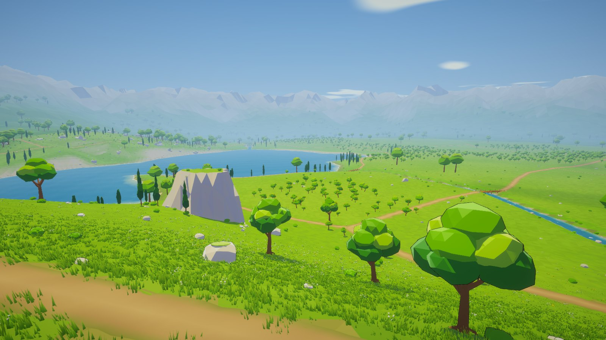

## Como abrir e jogar

- **No editor**: abra `Assets/Zeldexile/Scenes/ValeInicial.unity` e aperte Play. O jogador começa na entrada
  (U 503, V 116), ao lado de uma fogueira com panela, olhando para o norte.
- **Recriar a cena**: menu **Zeldexile → Recriar cena do Vale Inicial**
  (ou `-executeMethod Zeldexile.EditorTools.RegionSceneBuilder.Build`).
- **No build Windows**: `Builds/Windows/Zeldexile.exe` abre direto no vale (é a primeira cena do build).
  `-ilha` abre a ilha de protótipo e `-vitrine` a vitrine do herói. Para gerar o build sem recriar as cenas do
  protótipo: menu **Zeldexile → Gerar build Windows (cenas salvas)**.
- **Clima**: a altitude conta a partir dos prados (8 m acima do lago), com resfriamento suave (12% do da ilha):
  ~19 °C na entrada às 9h, nunca abaixo de 0 °C nem acima de 40 °C no vale (teste `ValleyIsNeverFreezingOrScorching`).
- **Build só do vale, para medir**: menu **Zeldexile → Gerar build de medição do Vale**
  (`Builds/ValeBench/Zeldexile.exe`). Para medir: `Zeldexile.exe -zxbench <pasta>`.
- **Controles**: os mesmos da ilha (README). Tudo o que o herói já faz funciona aqui: andar, correr, escalar
  árvores, rochas e penhascos, planar das colinas, nadar no lago, cozinhar na fogueira, pegar frutas e lenha.

## Escala, eixos e setores

| Item | Valor |
|---|---|
| Unidade | 1 unidade Unity = 1 metro (herói com 1,8 m, controlador com raio 0,35 m, rampa de 50°, degrau de 0,4 m) |
| Eixos | U (oeste → leste) = **+X** do Unity; V (sul → norte) = **+Z**; altura = **+Y** |
| Origem | canto sudoeste (U 0, V 0) = mundo (0, 0). Centro do vale (500, 500) |
| Referência de altura | superfície do lago = **Y 20** no mundo. Alturas do relevo são relativas a ela |
| Envelope medido (no motor) | **1.000,00 m × 1.000,00 m = 1,000 km²** (soma dos limites dos 25 setores de terreno) |
| Desnível | de −7,2 m (fundo do lago) a +120,4 m (topo da Mesa Norte) em relação ao lago |
| Grade do terreno | 2,5 m (401 × 401 amostras), faces chapadas com cor por face, no estilo do projeto |
| Setores | 25 setores lógicos de 200 × 200 m, ids estáveis `s{X}_{Z}` (aceitam negativos: `s-1_3`) |

Cada setor é uma malha + colisor próprio (`Setor s2_3`), construído das mesmas amostras compartilhadas nas
bordas: o teste `SectorEdgesMatchExactly` confere vértice a vértice que não há fendas nem degraus entre setores.
O carregamento por setor não existe no projeto ainda; com 25 setores tudo fica carregado (2,1 s de montagem).

## Plano do território

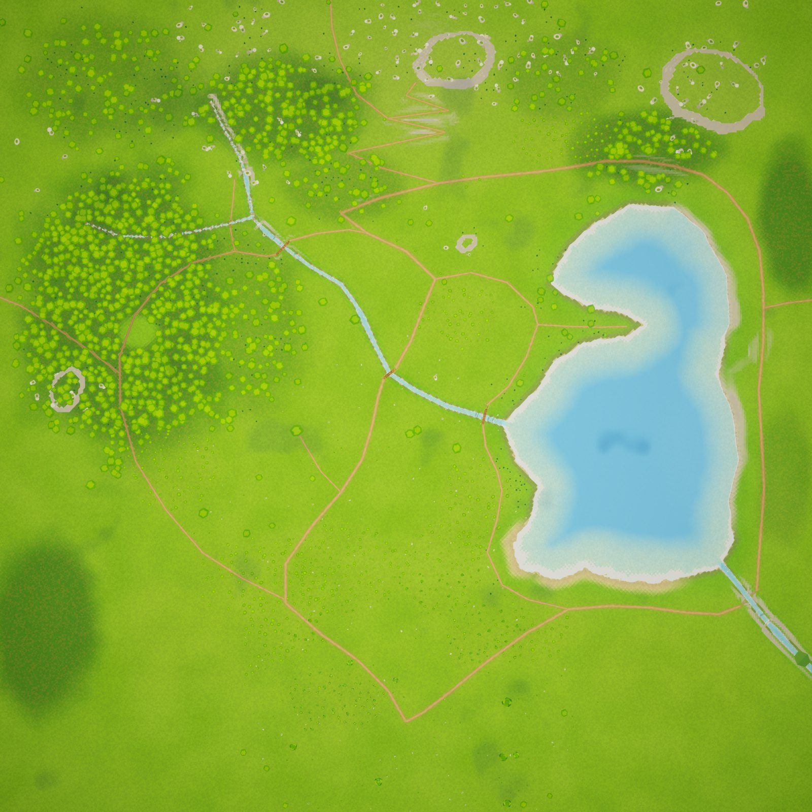

| Área | Posição (U, V) | O que tem |
|---|---|---|
| Entrada | 500, 110 | Clareira com fogueira e panela, trilha principal saindo para o norte, vista do vale |
| Pomar meridional | 285–420, 240–300 | Laranjeiras a oeste, pereiras a leste, de idades e copas diferentes |
| Prado central | 455, 430 | Prado aberto com flores brancas e amarelas, cruzamento de trilhas |
| Árvore Anciã | 365, 470 | Laranjeira gigante no outeiro do prado (marco visual) |
| Bosque ocidental | 160, 615 | Bosque denso sobre o planalto, clareira interna, riacho do bosque com raízes expostas |
| Riacho das Pedras | 262,872 → 640,474 | Nasce nas colinas, cai 4 m na Cachoeira, desce em cascatas e chega ao lago |
| Ponte Central | 480, 540 | Travessia do circuito principal |
| Lago Espelho | 618–910, 280–750 | Enseada (SO), península (O), praia de areia (S), margem arborizada (N), margem rochosa (L) |
| Colinas setentrionais | 500, 850 | Mirante do Vale (540, 772), Mirante do Pico (512, 890), Mesa Norte (120 m) |
| Mesa Nordeste e Pedra do Vigia | 875, 885 / 575, 700 | Torres de calcário claro com penhascos em degraus |
| Rio da Saída | 868,326 → borda leste | Sai do lago a sudeste por uma ravina com uma queda de 2,4 m |

### Cobertura do solo (medida no terreno construído)

Cada célula conta uma vez, pela cobertura dominante (`CoverStats`):

| Cobertura | Plano | Implementado |
|---|---:|---:|
| Campos, prados e clareiras | 42% | 48,8% |
| Bosques | 20% | 18,7% |
| Pomares | 16% | 12,4% |
| Água | 11% | 10,3% |
| Encostas rochosas e afloramentos | 11% | 9,8% |

Os pomares ficaram abaixo do plano: os maiores pomares encostam no lago e nas trilhas, onde não se planta.
Aumentar `pomar_*` em `vale_inicial.json` sobe a participação sem mexer em código.

## Relevo e água

O modelo (`Domain/Regions/RegionTerrain.cs`) monta o chão em camadas, sempre a partir dos dados:

1. **Escala grande**: base ondulada (ruído em 3 oitavas), 13 colinas com contorno irregular, 4 platôs de
   calcário com penhascos em degraus (`plateaus`).
2. **Escala média**: ondulação dos campos (70 m), barrancos, transição colina–planície pelas próprias colinas.
3. **Escala pequena**: rugosidade de 9 m, irregularidades junto às trilhas, raízes e pedras semienterradas
   (as pedras afundam 12–45% do tamanho no chão).
4. **Lago**: polígono irregular de 33 pontos (99.000 m²); plataforma rasa e caminhável de 14 m (mais larga na
   praia, quase nenhuma na margem rochosa), depois desce até 7 m. A margem sobe devagar na praia e rápido na rocha.
5. **Riachos**: o leito acompanha o chão sob a linha central, afundado 1–1,4 m, **nunca sobe rio abaixo**
   (teste `StreamsNeverRunUphillAndMeetTheLakeAtItsLevel`); trechos íngremes viram poços e cascatas de 1,1–1,4 m;
   quedas declaradas nos dados (`fall`) viram cachoeiras. Larguras de 2,2 a 10 m. O riacho que alimenta o lago
   chega exatamente no nível dele; o rio que sai começa nele e desce.
6. **Trilhas**: perfil suavizado e limitado em rampa (17% no circuito, 20% nas secundárias), com cortes e aterros
   de no máximo ~2,7 m; nas pontes, a trilha vira cabeceira firme na altura do tabuleiro.

Água visível: superfície do lago só sobre a bacia (nunca aparece através do chão), com cor por profundidade,
espuma na margem, reflexo do céu e ondas leves (`Zeldexile/Water`). Riachos e rio são faixas que seguem o leito,
com faixas de espuma correndo no sentido da descida, mais densas nos trechos íngremes, e borrifo ao pé das quedas
(`Zeldexile/Stream`). Natação usa o `WaterVolume` existente, no lago inteiro; as margens rasas continuam
caminháveis (o motor só nada onde a água passa do peito).

## Trilhas, circuito e pontes

| Trilha | Tipo | Comprimento | Percorrido com o herói | Subida total | Andando (4 m/s) | Correndo (7 m/s) |
|---|---|---:|---:|---:|---:|---:|
| Circuito do Vale | principal | 2280 m | 2284 m | 78 m | 9,5 min | 5,4 min |
| Trilha do Bosque | secundária | 763 m | 767 m | 49 m | 3,2 min | 1,8 min |
| Trilha do Oeste | secundária | 178 m | 178 m | 7 m | 0,7 min | 0,4 min |
| Trilha do Pico | secundária | 458 m | 451 m | 62 m | 1,9 min | 1,1 min |
| Passo do Norte | secundária | 176 m | 177 m | 1 m | 0,7 min | 0,4 min |
| Trilha da Margem | secundária | 597 m | 594 m | 11 m | 2,5 min | 1,4 min |
| Caminho da Península | acesso | 110 m | 109 m | 0 m | 0,5 min | 0,3 min |
| Acesso à Cachoeira | acesso | 89 m | 89 m | 13 m | 0,4 min | 0,2 min |
| Subida da Árvore Anciã | acesso | 89 m | 89 m | 6 m | 0,4 min | 0,2 min |
| Trilha da Costa Leste | secundária | 63 m | 63 m | 9 m | 0,3 min | 0,1 min |

O **circuito principal** liga entrada → pomar → prado central → Ponte Central → subida em zigue-zague → Mirante
do Vale → margem norte do lago → costa leste (trilha sobre os penhascos) → Ponte da Saída → praia do sul →
entrada. Rotas alternativas: Trilha do Bosque (pelo bosque ocidental e a Ponte do Bosque), Trilha da Margem (pela
margem oeste, Ponte da Foz e enseada), Trilha do Pico (até o topo), acessos à península, à cachoeira e à Árvore Anciã.

O teste `EveryPathCanBeWalked` percorre **todas** as trilhas com um `CharacterController` do tamanho do herói, na
velocidade de caminhada, e falha se ele ficar preso ou cair mais que um degrau.

| Ponte | Vão | Largura | Tabuleiro sobre a água |
|---|---:|---:|---:|
| Ponte Central | 18,7 m | 3,4 m | 1,9 m |
| Ponte do Bosque | 22,6 m | 2,8 m | 3,0 m |
| Ponte da Foz | 23,5 m | 3,0 m | 2,5 m |
| Ponte da Saída | 26,9 m | 3,4 m | 8,9 m (ravina, com pilares) |

Mesma linguagem nas quatro (tábuas atravessadas com variações, duas vigas, postes com corda frouxa, pilares
na água nos vãos longos, pedras nas cabeceiras), nenhuma idêntica. O piso é **uma caixa contínua** que entra 1,2 m
no chão de cada lado: os pés nunca prendem entre tábuas. Corrimãos com colisão de 1 m.

## Vegetação, pedras e detalhes

Distribuição por regras (`ScatterCatalog`), de acordo com altura, inclinação, umidade, distância da água e das
trilhas e as áreas de cobertura dos dados. Objetos sólidos guardam o próprio raio de distância das trilhas e
pontes (teste `SolidObjectsKeepOffPathsAndBridges`). Cerca de **40 mil objetos** desenhados com GPU instancing:

| Camada | Modelos (Blender) | Regras principais |
|---|---|---|
| Árvores de copa | `arvore_copa_0..2` | bosques, bordas de bosque, margem arborizada, poucas isoladas nos campos |
| Ciprestes | `cipreste_0..1` | em grupos, perto do lago, em encostas e afloramentos |
| Laranjeiras / pereiras | `laranjeira_0..3`, `pereira_0..3` | pomares; algumas soltas junto às trilhas. Jovem, adulta, aberta (galho baixo escalável), inclinada |
| Arbustos | `arbusto_0..2` | transição bosque–campo, pé de pedras, margens de riacho |
| Rochas | `rocha_0..2`, `rocha_grande_0..2`, `seixo_0..2` | afloramentos, penhascos, pés de cachoeira, margens rochosas, riachos; parcialmente enterradas |
| Troncos, tocos, galhos | `tronco_caido_0..1`, `toco`, `galho_0..2` | chão do bosque e beiras de riacho; deitados acompanhando o declive |
| Samambaias | `samambaia_0..1` | sombra úmida do bosque e beira de riacho |
| Juncos | `junco_0..1` | margem rasa do lago e bordas dos riachos |
| Flores | `flor_branca_0..1`, `flor_amarela_0..1` | prados floridos e manchas nos campos |
| Grama | tufo do projeto (`Zeldexile/Grass`) | gerada por células de 16 m só perto da câmera; mais alta nos prados, rala sob árvores, ausente nas trilhas |

Marcos únicos: Árvore Anciã (`arvore_ancia`), fogueira da entrada. Pontos de interesse: Mirante do Vale, Mirante
do Pico, Árvore Anciã, Clareira do Bosque, Enseada Rasa, Ponte Central, Cachoeira do Riacho, Pedra do Vigia,
Raízes do Riacho do Bosque, Ponta da Península, Prado das Flores, Praia do Sul.

**Coletáveis** (sistema existente `MaterialPickup`): frutas caídas sob ~30% das frutíferas (novos materiais
`laranja_vale` e `pera_dourada`, cozináveis) e lenha em 12% dos galhos do chão. Cada um tem id estável
(`vale_inicial/laranjeira/45_27/fruta0`). Frutas nas copas são só visuais por enquanto.

Vento: uma direção para tudo (copas, grama, flores, juncos), com rajadas que atravessam o vale.
Contorno escuro só de perto (como os personagens); de longe, árvores trocam para a versão simples (`_lod`).

## Bordas e expansão

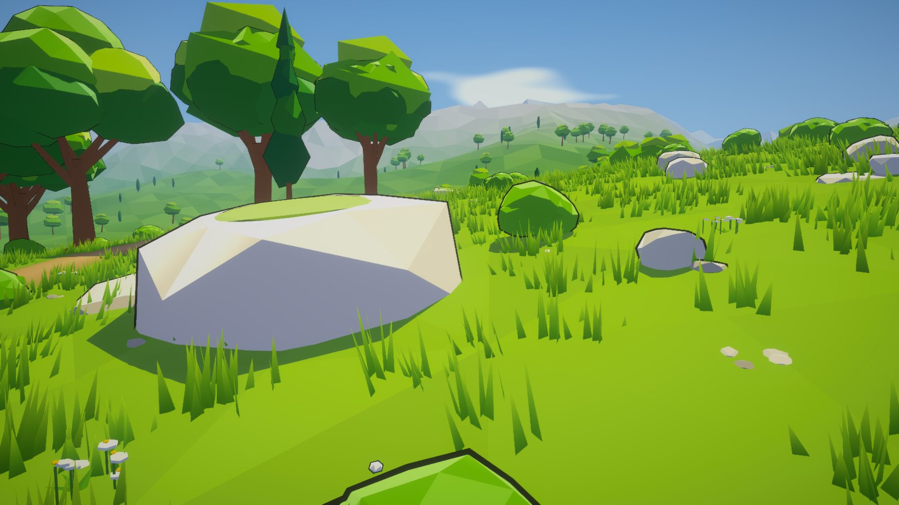

Enquanto não há vizinhos, muros invisíveis altos nas quatro bordas seguram o jogador (mecanismo já usado na ilha),
uma mensagem avisa que o caminho continua depois, e quem cair para fora do mundo volta à entrada. Em volta,
um anel de **cenário distante** (não caminhável, fora do km²) continua as bordas e sobe em colinas e serras;
basta apagá-lo (`Cenário distante`) quando um vizinho existir.

Conexões preparadas para o futuro (alturas medidas no terreno construído):

| Conexão | Borda | Posição (U, V) | Altura sobre o lago | Y no mundo | Largura | Terreno / vegetação | Restrições |
|---|---|---|---:|---:|---:|---|---|
| Passo do Norte | Norte | 408, 1000 | 59,9 m | 79,9 | 2,6 m | sela entre colinas, encosta suave; bosque ralo e campo alto; trilha de terra e pedras | manter a sela abaixo de 80 m e continuar a trilha para o norte |
| Trilha do Oeste | Oeste | 0, 634 | 26,3 m | 46,3 | 2,4 m | planalto ondulado; bosque denso; trilha de terra com raízes | bosque deve continuar com a mesma densidade por 60 m |
| Rio da Saída | Leste | 1000, 176 | -3,4 m | 16,6 | 8,0 m | ravina baixa; juncos e bosque ralo; leito de seixos e calcário; água: rio de 8 m, superfície 3,4 m abaixo do lago na borda, descendo | o vizinho deve continuar descendo o leito, sem represas |
| Trilha da Costa Leste | Leste | 1000, 630 | 32,9 m | 52,9 | 2,8 m | encosta média sobre o lago; bosque ralo e rochas; trilha de terra | a colina leste continua e a trilha segue em patamar |

### Como acrescentar uma região ao norte

1. Crie `Assets/Zeldexile/Resources/World/Regions/<id>.json` com `originX: 0`, `originZ: 1000` (múltiplos de 200),
   o mesmo `cellSize` (2,5) e um `seed` próprio. Nada mais precisa ser registrado: o `WorldAtlas` lê todos os
   arquivos da pasta e recusa sobreposições.
2. Ao construir o terreno da nova região, passe para `new RegionTerrain(dados, alturaDaBordaVizinha)` uma
   função que devolve a altura (Y no mundo) do vale nos pontos da borda comum (`HeightField.WorldY` do vale).
   A nova região se funde a ela numa faixa de 60 m (`relief.edgeBand`) e coincide exatamente na linha da costura
   — é o que o teste `ANorthNeighborJoinsWithoutSeamOrMovingAnything` faz com uma região de teste.
3. Continue a trilha `passo_norte` a partir de (408, 1000) e retire o muro norte e o cenário distante daquele lado.
4. O vale não muda: alturas, objetos e ids continuam os mesmos (o mesmo teste confere).

## Desempenho (medido no build Windows)

Build de medição (`Builds/ValeBench`), `-zxbench`, 1920×1080, qualidade Ultra (sombras até 150 m), VSync desligado.
Máquina: Intel Core i9-13900K (32 threads), 64 GB RAM, NVIDIA GeForce RTX 4070 Ti (Direct3D 12).

| Trecho | Quadros | Média | p95 | Pior | FPS médio | Lotes de natureza | Instâncias desenhadas |
|---|---:|---:|---:|---:|---:|---:|---:|
| ponto entrada | 1365 | 2.20 ms | 2.53 ms | 3.06 ms | 455 | 1427 | 4171 |
| ponto vale_amplo | 1679 | 1.79 ms | 2.04 ms | 3.95 ms | 560 | 1189 | 4436 |
| ponto pomar_lago | 1894 | 1.58 ms | 1.99 ms | 3.87 ms | 631 | 896 | 2351 |
| ponto ponte_riacho | 2036 | 1.47 ms | 1.71 ms | 2.19 ms | 678 | 881 | 3319 |
| ponto bosque | 1549 | 1.94 ms | 2.25 ms | 5.23 ms | 516 | 1257 | 5542 |
| ponto margem_rasa | 2384 | 1.26 ms | 1.44 ms | 3.39 ms | 794 | 871 | 2345 |
| ponto mirante | 1710 | 1.76 ms | 2.03 ms | 4.11 ms | 570 | 1270 | 4258 |
| ponto borda | 3317 | 0.90 ms | 0.99 ms | 5.43 ms | 1106 | 288 | 1151 |
| ponto cachoeira | 2087 | 1.44 ms | 1.59 ms | 2.61 ms | 696 | 800 | 3248 |
| ponto peninsula | 2621 | 1.14 ms | 1.27 ms | 2.67 ms | 873 | 584 | 1793 |
| sobrevoo do circuito principal (6 m/s) | 31681 | 1.89 ms | 2.21 ms | 6.54 ms | 528 | 1396 | 5089 |

- Montagem da região por etapa (ms acumulados): relevo 491, jogador 524, terreno e trilhas 779, água 792, pontes 805, vegetação e rochas 2060, marcos 2072, horizonte e limites 2136
- Objetos instanciados: 40407 em 6449 lotes; colisores 5331; coletáveis 782
- Memória: alocada 485 MB, reservada 813 MB, mono 35 MB

Técnicas usadas e medidas: instancing por células de 50 m com corte por distância e frustum; troca de malha
(árvores) a 150 m; contorno só até 60–160 m; sombras só de árvores, rochas, troncos e pontes, dentro da distância
de sombra; plantas pequenas sem sombra e com distância curta; grama gerada por célula perto da câmera (no máximo
6 células novas por quadro); colisores só em troncos, rochas, troncos caídos, tocos e pontes (nenhum corpo físico
por galho ou flor); relevo calculado em paralelo (0,5 s no build). A meta de desempenho do projeto não existe
ainda; como referência provisória: **≥ 60 fps a 1080p em placa de vídeo média**. A máquina medida passa com folga;
falta medir em hardware modesto (veja "Pendências").

## Validações executadas

- **EditMode** (`Tests/EditMode/RegionTests.cs`, 12 testes): envelope e grade, ids de setor com negativos, atlas de
  25 setores e 20 vizinhos livres, costura exata com uma região ao norte sem mover nada do vale, riachos que nunca
  sobem e encontram o lago no nível, riachos afundados nas margens, trilhas com rampa limitada e secas, pontes acima
  da água com cabeceiras niveladas, cobertura perto do plano, distribuição determinística com ids únicos, sólidos
  fora das trilhas, entrada plana e seca.
- **PlayMode** (`Tests/PlayMode/RegionWorldTests.cs`, `RegionCaptureTests.cs`): a região monta com seu conteúdo;
  envelope medido de 1.000 × 1.000 m; bordas de setor idênticas; nenhum buraco (raio a cada 10 m em todo o km²);
  entrada segura; tabuleiro contínuo nas quatro pontes; todas as trilhas percorridas pelo controlador do herói;
  capturas, vista superior e vídeo de exploração.
- Os testes já existentes do projeto continuam passando (49 em EditMode; ilha, ganchos e modelos em PlayMode).

## Capturas (renderizadas pelo jogo)

Pontos documentados em `shots` do JSON (repetíveis para comparação): `Logs/vale/capturas.csv`.

| | |
|---|---|
| 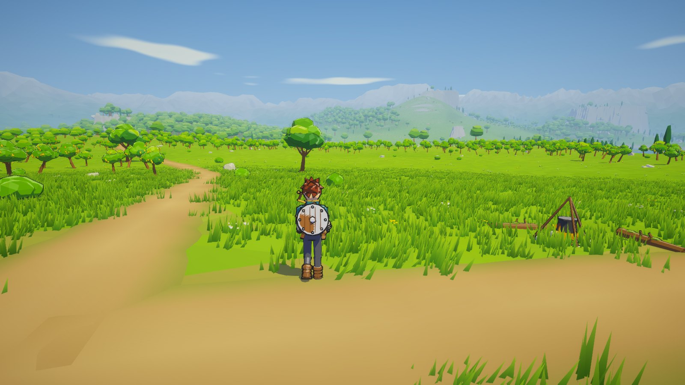 | 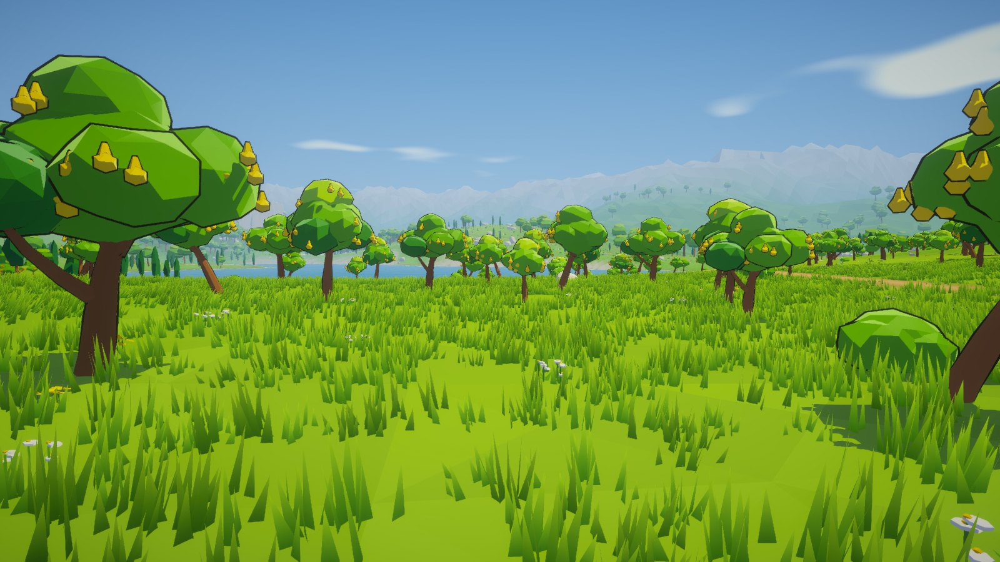 |
| 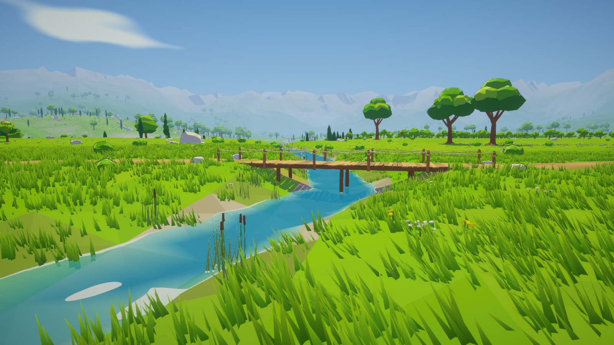 | 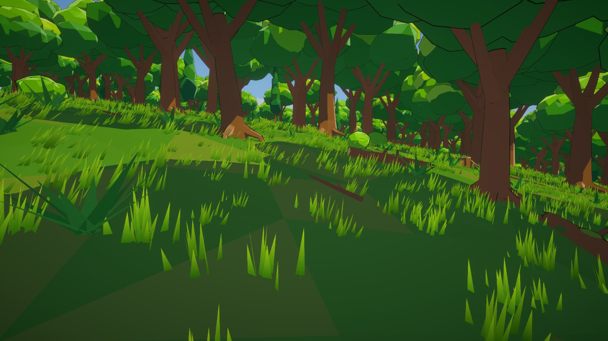 |
| 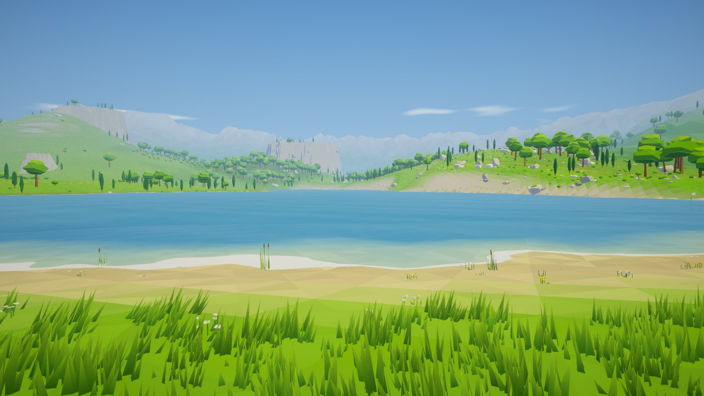 | 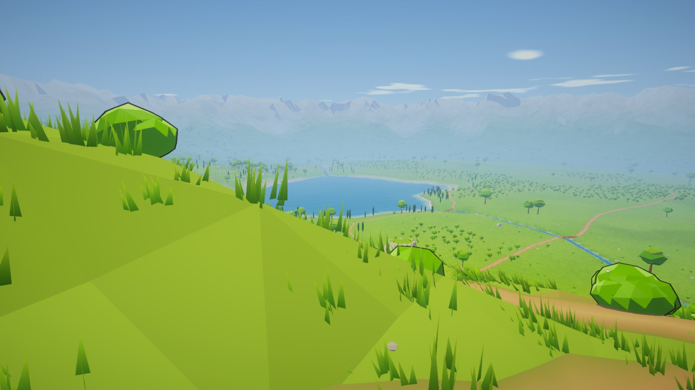 |
| 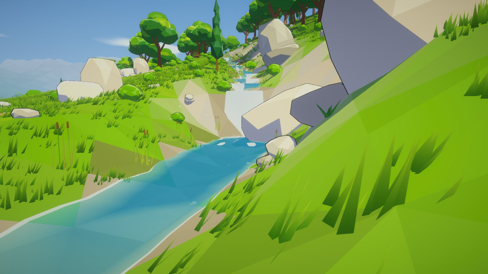 | 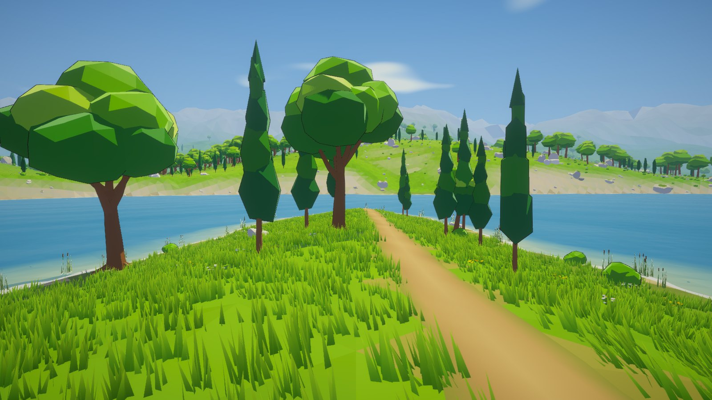 |
| 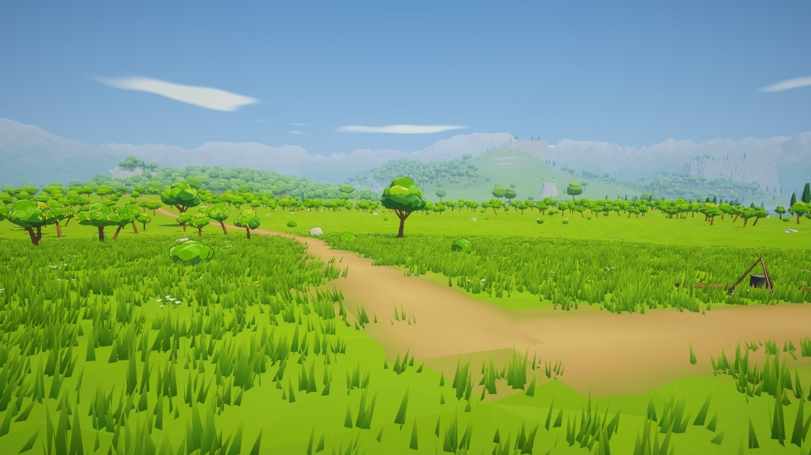 | 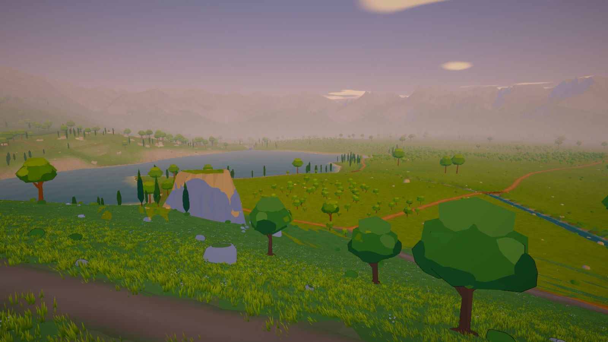 |

Vídeo: [media/vale-passeio.mp4](media/vale-passeio.mp4) — o herói andando três trechos do circuito (entrada e
pomar, Ponte Central, margem norte), pela câmera de jogo. O herói é movido pelo teste ao longo da trilha (a entrada
de controle não é simulada); o resto é o jogo rodando.

## Arquivos

**Dados**: `Resources/World/Regions/vale_inicial.json` — colinas, platôs, lago, riachos, trilhas, pontes, áreas de
cobertura, pontos de interesse, conexões, entrada e pontos de captura.

**Domínio (C# puro, testável fora do Unity)** — `Scripts/Domain/Regions/`: `RegionMath` (ruído e utilidades),
`Sectors` (`SectorCoord`, `WorldGrid`, `WorldAtlas`), `RegionData`, `Polylines`, `RegionTerrain`, `HeightField`
(+ `CoverStats`), `Scatter` (`ScatterCatalog`, `Scatterer`).

**Runtime** — `Scripts/Runtime/World/Region/`: `RegionLibrary`, `RegionTerrainBuilder`, `PathRibbonBuilder`,
`RegionWaterBuilder`, `BridgeBuilder`, `InstancedNature`, `NatureMeshes`, `NaturePalette`, `StreamedGrass`,
`FarScenery`, `RegionLimits` (+ `WaterSpray`), `CampfireLook`; `Scripts/Runtime/Gameplay/RegionWorld.cs`
(monta tudo) e `RegionBenchmark.cs`.

**Shaders** — `Resources/Shaders/`: `Foliage`, `FoliageOutline`, `Foliage.cginc`, `Stream`, `SoftParticle`.
Materiais salvos (variantes de instancing no build): `Resources/Materials/Folhagem`, `FolhagemContorno`, `Riacho`.

**Modelos** — `Tools/Blender/build_nature.py` gera `Resources/Models/Nature/*.fbx` (67 modelos, incluindo versões
`_lod`) e as fontes editáveis em `Art/Blender/Natureza/*.blend`:

```
"E:\Steam\steamapps\common\Blender\blender.exe" -b --factory-startup -P Tools/Blender/build_nature.py -- "Zeldexile/Assets/Zeldexile/Resources/Models" "Art/Blender/Natureza"
```

**Editor** — `Scripts/Editor/RegionSceneBuilder.cs`; cena `Scenes/ValeInicial.unity`.

**Alterados (mudanças pequenas)**: `PrototypeWorld` (modo `PlayerOnly` para regiões montarem só o jogador),
`AtmosphereController` (`FogDistanceScale`), `ToonLighting.cginc` (luzes extras não clareiam mais o retângulo
inteiro da luz — bug latente que a fogueira revelou), `GrassField` (`BuildClump` público), `Materials` (duas
frutas), `ModelImportSettings` (modelos de natureza legíveis), `PrototypeSceneBuilder`/`WindowsBuild`/`BuildCapture`
(cena do vale no build e `-vale`), `build_models.py` (`main()` protegido para reutilizar as funções),
`Tools/DomainCheck` (inclui o domínio das regiões).

Todos os recursos são próprios, gerados por código. Os mockups ficam só como referência conceitual (não estão no
projeto como recursos do mundo).

## Pendências reais

- **Desempenho em hardware modesto**: só medido numa máquina topo de linha. Faltam medições numa placa de entrada
  e definir a meta oficial.
- **Áudio ambiente**: o projeto não tem estrutura de áudio; o vale não tem sons ainda.
- **Frutas nas copas**: são visuais; derrubá-las (golpe, flecha, sacudir) depende de uma mecânica que não existe.
- **Ciclo de dia**: verificado ao meio-dia, às 10 h e no pôr do sol (capturas); a noite não foi revisada no vale.
- **Carregamento por setor**: não existe no projeto; os 25 setores ficam carregados (2,1 s de montagem, 485 MB
  alocados). Os dados e ids por setor já permitem ligar/desligar setores quando isso for necessário.
